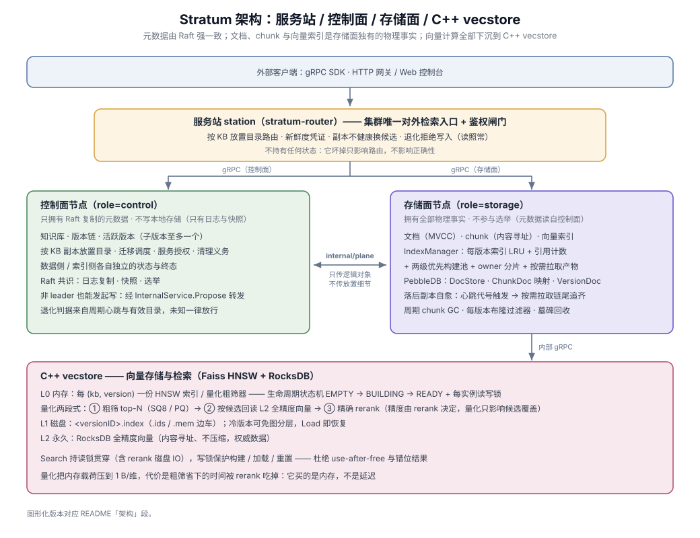
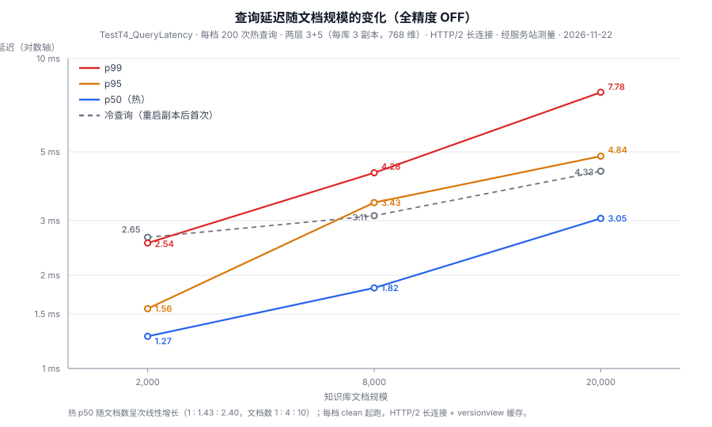

# Stratum

[](https://github.com/Hk-owo/stratum-vectordb/actions/workflows/ci.yml)
[](https://codecov.io/gh/Hk-owo/stratum-vectordb)
[](https://go.dev/doc/go1.24)
[](LICENSE)

**为 RAG 构建的分布式、版本化向量知识库。** 每次文档更新都产出一个可回滚、可审计的 MVCC 版本；元数据由自研 Raft 强一致复制，向量由 C++ Faiss HNSW 索引。

---

## 它解决什么问题

RAG 的知识库不是一次写入就不动的。实际使用里有三个常见痛点：

| 痛点 | Stratum 的做法 |
|---|---|
| 更新了一批文档后检索质量变差，想**立刻退回**去 | 知识库以 MVCC 版本链组织，`RollbackVersion` 一次调用切换活跃版本，不停服 |
| 回答出错时，说不清**当时检索的是哪一版文档** | 查询永远落在一个明确的版本上，结果可追溯到产生它的版本 |
| 文档只改了一小段，却要**整篇重新 embed** | 内容定义分块（CDC）+ 内容寻址 ChunkID，未变的 chunk 原样复用、在 embed 之前就被跳过 |

Stratum 只做 RAG 管线的**存储与检索层**；聊天历史、会话与 prompt 构造属于其上的应用层。

## 关键数据

| 指标 | 结果 | 说明 |
|---|---|---|
| 查询延迟（热 p50） | **4.20 / 9.63 / 16.08 ms** | 2k / 8k / 20k 篇文档，768 维，3+5 集群每库 3 副本，经服务站测量 |
| 按 KB 放置（3+5 每库 3 副本） | 副本放大率 **0.60×**；热 p50 **2.77 ms** | 5 存储节点承载 5 个 KB，每节点仅存 3/5 个 KB，控制面非 OK RPC 为 0 |
| 中部编辑后 chunk 复用 | ChunkID 保留率 **0% → ~95%**；需重新 embed 的文本 **64% → 10%** | CDC 对比滑动窗口，同一批真实语料 |
| 索引构建次数 | **−24%**（8 个版本：21 → 16 次） | 索引 owner 分片：每版本只由 owner 集持有 |
| 墓碑回收 | 索引产物 66.1 MB → 24.3 MB（**−63.2%**） | 2,000 篇删除 80% 后，3+5 每库 3 副本滚动回收，回收期间查询不中断 |
| 写入 API | 20,000 篇 / 20 批合计 **0.55 s** | 写入与索引构建解耦；3+5 放置下 10,000 篇提交 0.31 s（≈ 32.2k docs/s） |
| 测试 | **1,744** 个 Go 测试函数 + vecstore **74** 个 C++ 用例 + **35** 个 Docker 集群集成测试 | CI 跑单测、`-race` 与真实集群集成 |

完整读数与测量口径见下方[性能实测](#性能实测)。

## 架构



```
  客户端（gRPC SDK / HTTP 网关 + Web 控制台）
                 │
  服务站 stratum-router ── 无状态：选副本、换候选、熔断、鉴权、写入门控
        │                        │
  控制面（role=control）    存储面（role=storage）
  Raft 复制的元数据：       全部物理事实：文档(MVCC) · chunk ·
  知识库 · 版本链 ·         每版本索引 · 复制 · 追赶与修复
  活跃版本 · 副本可用性            │ gRPC
                            C++ vecstore：Faiss HNSW（L0 内存）
                            · .index 产物（L1 磁盘）· RocksDB 全精度向量（L2）
```

分层的原则是**每一层只拥有自己该知道的事**：

- **服务站**只决定"发给谁、怎么重试、要不要拒"，不持有状态，坏掉只影响路由、不影响正确性，可水平扩展；
- **控制面**只回答"哪些版本存在、谁是活跃版本、有多少副本就绪"，**不写本地数据**；
- **存储面**拥有文档、chunk、向量索引与复制；向量计算全部下沉到 C++ vecstore，Go 层只做编排。

两层之间的契约（`internal/plane` 的 `ControlPlane` / `DataPlane`）只传逻辑对象，从不暴露副本数、文件路径或节点身份，所以既能同进程运行（`role=all`，默认），也能拆成独立集群。

## 核心设计与取舍

每一条按"问题 → 做法 → 代价"组织。

### 1. MVCC 版本链，且刻意保持严格线性

- **做法**：`CreateVersion` 一次应用任意数量的 ADD / DELETE / UPDATE，产出新版本；未变更的文档借助 PebbleDB 的前缀编码零拷贝继承。父版本必须已就绪，且**最多只能有一个子版本**。
- **为什么拒绝分叉**：文档读取沿祖先链解析，两条分支会让一条分支读到兄弟分支的写入。线性链让"某版本包含哪些文档"始终有唯一答案。
- **细节**：建库时不创建版本（惰性根）——因为"空的 changes"在链中间意味着"与父版本相同"，在根部却意味着"空集"，两种语义只在根部重合，所以空 changes 直接被拒。删除支持 `SUBTREE` / `SINGLE`（子版本改挂到父版本）/ `ANCESTORS` 三种模式。

### 2. 内容定义分块 + 内容寻址 chunk

- **问题**：按固定偏移切块时，文档中部插入一句话会让其后所有 chunk 边界整体平移，全部需要重新 embed。
- **做法**：边界来自文档字节上的滚动 Rabin 指纹，再吸附到句末标点、对齐到 rune 起点（后者是正确性要求，不是调参）。`ChunkID = SHA-256(text + model ID)`，天然去重、无需跨节点协调；写路径在 **embed 之前**用 Bloom + Exists 过滤已持有的 chunk，复用真正省下 embedding 调用，复用率落进日志可观测。
- **代价**：切块算法按知识库固定、创建后不可变——同一库的不同版本必须切得一样，否则同一段文本会产出不同 ChunkID。

### 3. 每版本一份索引 + owner 分片 + 按需拉取

- **做法**：每个 (知识库, 版本) 一份独立 HNSW 索引，版本之间零干扰；索引**不在所有副本上复制**，而是按 (知识库, 版本) 确定性算出 owner 集（活跃版本所有副本都是 owner，非活跃版本按近期是否被查询加档）。需要索引的副本向持有者**拉取**产物直接装载，拉不到再自建；同一版本的并发拉取会合并成一次读盘。
- **调度**：构建池是两级优先队列——有人在等的实时构建永远先于后台补建，补建积压再多也挡不住一次实时写入。
- **代价**：构建总成本随**版本数**超线性增长（3+5 每库 3 副本下 8 批 → 20 批：2 m 10 s → 8 m 59 s）。owner 分片减少的是持有份数，而非单份成本；纯追加的版本会以父版本产物为起点只追加新 chunk 来缓解。

### 4. Raft + WAL，围绕"崩溃后仍然正确"设计

- 元数据写经 leader 提交，并受 WAL 保护；快照不阻塞心跳与写入。
- **任何节点都能发起写**：非 leader 经 `InternalService.Propose` 转给 leader，不成链；错误以稳定的 wire name 跨进程传递，转发后 `errors.Is` 依然成立。
- **写幂等**：`CreateVersion.client_request_id` 让重试复用首次分配的版本，而不是再分配一个。
- 存储节点的"连续数据游标"同样持久化在 WAL 中，重启后立即准确，不靠扫描磁盘推断。
- **落盘校验与顺序**：WAL 记录帧与 vecstore 索引旁车统一采用硬件加速的 **CRC-32C**（Castagnoli）；WAL 启用分组提交与目录 fsync，写/删路径在写 WAL 提交记录前先 flush vecstore。

### 5. 卡住的版本必须有名字

一个只会"一直 PENDING"的版本对调用方毫无信息量。Stratum 把版本状态拆成**数据侧**（PENDING / DURABLE / FAILED_PERMANENT）与**索引侧**（PENDING / READY / FAILED / FAILED_PERMANENT）两条独立的线：

- **DATA_MISSING**：没有任何副本持有数据（例如写入方在分配版本后崩溃）——客户端可按同一幂等键重发，或 `DiscardVersion` 放弃；
- **FAILED_PERMANENT**：重试预算耗尽，只有运维能 `ForceRetryVersion`（仅限索引侧）或 `ForceAbandonVersion`；
- **只有数据侧终态才触发物理回收**——索引构建失败不代表数据坏了，删掉数据会毁掉重建所需的输入。
- **父版本的数据侧还没 durable 时，下一批写入返回可重试的 `parent_not_durable`**——追赶副本可能先把父版本的索引建好、而写方的 digest 还在 Raft 路上，这个窗口是正常的，等一会儿重发即可；它不是"请求非法"，也不计入失败预算。

### 6. 落后副本自愈 + 读的新鲜度凭证

- 存储节点每 5 秒发一次固定大小的心跳，响应里只带 `chain_generation` 与 `directory_revision`；任一代号变化时节点才按自身负责的 KB 拉取链尾或刷新放置。落后节点在后台先补数据、再补索引。缺口能逐版本重放时走 WAL 增量，缺口里含已删除版本时退回全量状态传输。这里**没有开关**，能调的只是节奏（滞后阈值、抖动、并发上限）。
- 追赶拿到的数据**不由追赶方宣布 durable**：单副本持有不等于 quorum。追赶完成后它启动的是一次 quorum 检查，数够了才上报——已 durable 的版本直接跳过。
- 数据源解析有四层兜底（全部限定在当前 KB 的有效副本集内）：本地注册表 → leader → 游标探测 → 落后节点探测 peer 游标后写入的本地缓存（查表即得，绝不在 Raft apply 路径上发 RPC）。
- 服务站转发查询时附上"应看到的最低版本"与 `placement_epoch`，存储节点游标不够就拒——**把"悄悄返回过时结果"变成显式失败**，再换一个达标副本；过期 epoch 或非成员响应触发单次目录刷新重试。
- 服务站路由不依赖任何节点上报：先问当前 KB 放置内该版本的 owner（哈希算出），都失败再问集合内其余副本。拒绝里带着节点游标，服务站记 3 秒，这期间把它排到最后而不是剔除，记录丢了最多多一次往返。

### 7. 存储退化是显式信号：写拒绝、读照常

- 按 KB 有效副本集合计算 quorum；低于 quorum 时写入返回 `kb_storage_degraded` / `storage_unavailable`（可重试），正在删除或删除失败（`DELETING` / `DELETE_FAILED`）的 KB 直接拒绝写入 `knowledge_base_deleted`。读照常服务，查询响应带 `storage_degraded` 位，只读客户端无需先撞一次写失败才知道。
- 判据来自周期心跳与有效放置目录，**判不出时一律放行**：leader 换届瞬间变成写熔断是不可接受的。
- 两道门：服务站转发前拦一次（省掉往返），控制面在提交 Raft 前再拦一次（不浪费版本号与日志），两处报同一个错误名。

### 8. 可选的量化两段式检索

- 建库时可选 `SQ8` / `SQ_FP16` / `SQ_BF16` / `PQ`：内存只驻留量化粗筛器，查询先粗筛候选，再读 RocksDB 中的全精度向量精确 rerank——**最终精度由 rerank 决定，量化只影响候选覆盖**。
- 选型：对比 hnswlib（无量化）、DiskANN、USearch 后选 Faiss 内建 `IndexHNSWSQ` / `IndexHNSWPQ`，零新依赖，与现有序列化格式兼容。
- 码本会随数据分布漂移，所以累积新增向量比例或追加次数越界时自动全量重训。
- **实测结论**：在 2 万篇以内的规模，量化买到的是内存（4 B/维 → 1 B/维），不是延迟。

### 9. 服务站与网关分成两层，安全边界只有一处

- 服务站（gRPC，`:7009`）负责 leader 发现、按 KB 目录路由、写转发、读均衡、熔断与鉴权；网关（HTTP，`:8081`）只做 HTTP→gRPC 转换并托管 Web 控制台，不知道集群拓扑。程序接入只需服务站，网关是可选适配层；两层容器部署下目录登记容器名时，服务站需跑在集群网络内。
- 节点只接受带服务站信任标记的客户端调用，标记是带时间戳的 **HMAC-SHA256**，不可伪造且过期即失效；`StorageAdminService` 另要求凭据显式配置 `storage_admin: true`；vecstore 的文件类 RPC 只允许在索引目录内读写，且明确排除 RocksDB 目录。

### 10. 按 KB 副本放置与在线单成员迁移

- **做法**：控制层 Raft 目录维护稳定节点表、每 KB 有效副本集合（建库可通过 `storage_replica_ids` 指定，缺省覆盖全部活跃未屏蔽存储节点）、单调 `placement_epoch` 与 KB tombstone；非成员节点拒绝数据写入、追赶与查询（`not_kb_replica`）。`StorageAdminService` 支持在线单成员替换与整节点原子排空（`DrainNode`）：先持久化执行围栏（`ExecutionGate`）排空旧写入 → 导出并校验全量传输帧 → 独占导入并重读可服务状态 → Raft 原子切换集合、提升 epoch 并持久化退出副本的后台清理义务。
- **代价**：单次迁移只替换一个成员，且同一 KB 不允许并发迁移；地址更新与节点退役要求先排空且无未完成清理义务，退役节点 ID 永不复用。

## 工程实践

- **测试**：35 个 Go 包中 30 个带测试，共 **1,744** 个常规测试函数；vecstore **74** 个 C++ 用例（另有 3 个基准测试）；`integration/docker` **35** 个集群集成测试在真实 3+3 / 3+5 集群上覆盖幂等、追赶、退化、换出、回收、重叠放置、迁移与排空退役等场景。CI 跑单测 + 覆盖率、`-race`（共识与索引核心）与 Docker 集成。
- **可观测**：三态健康检查、Prometheus `/metrics`（含每方法 gRPC 请求计数、请求/响应字节与耗时直方图）、查询与写入分段计时（`query: stage timings` / `write: stage timings`），以及 `GetSystemStatus` 中的卡住 / 数据缺失 / 永久失败 / GC 受阻版本列表。

## 性能实测

> **2026-11-17（当前代码，两层 3+5 拓扑）**：控制组 3 + 存储组 5（每个存储容器自带真实 Faiss HNSW + RocksDB，768 维），宿主 12 核 / 7.2 GiB 内存，服务站运行在集群网络 `stratum-net` 内。每档前均执行 `clean` 重建全新集群、`info` 级日志（`debug` 分段采样单列）。压测用例通过 `STRATUM_STRESS_REPLICAS=3` 显式按 `storage_replica_ids=[11,12,13]` 落入 3 个存储副本（quorum 2），其余 2 个存储节点（14/15）不承接该库；多库轮转分摊由 `TestStorageTopologyPerf_PlacementProfile` 测量。

### 查询延迟（全精度，`TestT4_QueryLatency`，每档 200 次热查询，3 副本）



| 指标 | 2,000 篇 | 8,000 篇 | 20,000 篇 |
|---|---|---|---|
| 冷查询（重启副本后首次，需从磁盘 Load） | 4.50 ms | 15.57 ms | 20.78 ms |
| p50（热） | **4.20 ms** | **9.63 ms** | **16.08 ms** |
| p95 | 5.95 ms | 12.67 ms | 19.88 ms |
| p99 | 7.45 ms | 16.41 ms | 21.91 ms |
| 全零向量对照 p50 | 4.44 ms | 9.15 ms | 14.57 ms |

热 p50 随文档数呈次线性增长（1 : 2.29 : 3.83，文档数 1 : 4 : 10）。冷热分开报：首次查询要把产物从磁盘装回内存，两者混在一起取平均既不描述常见情况，也不描述最坏情况。

### 查询耗时构成（存储节点内，µs）

| 段 | 做什么 | 2,000 篇 p50 | 8,000 篇 p50 |
|---|---|---|---|
| `filter_us` | 候选的版本过滤 + 聚合 | **2325** | **5460** |
| ↳ `chunkmap_us` | 每个候选 chunk 查一次所属文档 | 1252 | 2742 |
| `search_us` | vecstore HNSW 检索 | 383 | 280 |
| `meta_us` | 读版本元数据 | 245 | 178 |
| `read_us` | 读命中文档正文 | 86 | 122 |
| `bloom_us` | 布隆过滤（版本文档集指纹缓存后） | **2** | **2** |
| **`total_us`** | 合计 | **3375** | **6846** |

（`debug` 日志级别下采集，每档 256 / 260 条样本，此表看构成与占比。）

### 量化对照（`SQ8` vs 全精度，三档全部实测）


| 规模 | `OFF` 冷 / p50 / p95 / p99 | `SQ8` 冷 / p50 / p95 / p99 |
|---|---|---|
| 2,000 篇 | 4.50 / **4.20** / 5.95 / 7.45 ms | 9.05 / **5.94** / 9.29 / 12.28 ms |
| 8,000 篇 | 15.57 / **9.63** / 12.67 / 16.41 ms | 12.47 / **8.93** / 13.24 / 16.49 ms |
| 20,000 篇 | 20.78 / **16.08** / 19.88 / 21.91 ms | 33.21 / **18.65** / 23.83 / 25.55 ms |

三档下 `SQ8` 与全精度延迟差均落在轮间噪声范围内（不作因果归因）；结合 1 B/维的向量存储，结论依然是"买的是内存（降为 1/4），不是延迟"。

### 写入与索引构建（`TestT4_DataVolume`，每批 1,000 篇，3 副本）

| 规模 | 写入 API 合计 | 累计索引构建 | 端到端 | 3 副本目录合计（非副本 2 节点） |
|---|---|---|---|---|
| 2,000 篇（2 批） | 66.2 ms | 46.40 s | 46.47 s | 69.42 MiB（各 2.33 MiB 基线） |
| 8,000 篇（8 批） | 183.7 ms | 2 m 09.9 s | 2 m 10.1 s | 170.36 MiB（各 2.33 MiB 基线） |
| 20,000 篇（20 批） | 553.6 ms | 8 m 58.6 s | 8 m 59.1 s | 324.56 MiB（各 2.33 MiB 基线） |

写入 API 几乎与规模无关，代价集中在异步索引构建，并随版本数超线性增长；非副本存储节点（`storage4` / `storage5`）保持 2.33 MiB 空库基线不落入数据。同轮多版本换出（`TestT4_MultiVersionEviction`，8 版本 × 3 轮共 24 次查询）全部应答（91.9 s）；墓碑回收（`TestT4_GCPressure`，2,000 篇删 80%）产物由 66.1 MB 降至 24.3 MB（**−63.2%**），回收后查询正常（79.9 s）。

### 按 KB 副本放置（`TestStorageTopologyPerf_PlacementProfile`，3+5 集群，每库 3 副本）

5 个 KB 轮转放置在 5 个存储节点上（`[11,12,13]` … `[15,11,12]`），每库写入 2,000 篇（分 2 批 × 1,000）并执行 100 次热查询（共 10,000 篇、500 次查询）：

| 维度 | 实测读数 | 说明 |
|---|---|---|
| 写提交（10 批） | 合计 **310 ms**（均值 **31 ms/批**，**32,215 docs/s**） | 异步接受；全成员追赶合计 1 m 22.0 s |
| 经服务站热查询（500 次） | p50 **2.77 ms** · p95 **5.91 ms** · p99 **10.63 ms** | 含偶发冷构建的均值 32.61 ms |
| 放置与磁盘 | 每节点 **3/5** 个 KB（102–107 MiB/节点） | 配置 15 副本 vs 全量 25 副本，**放大率 0.60×** |
| 控制面 RPC 流量 | `GetStorageDirectory` 10.73/s（0.06 ms）· `Heartbeat` 1.62/s（0.85 ms） | **非 OK 调用 0 次** |

## 快速开始

```bash
# 构建与测试
go build ./cmd/stratum/
go test ./... -timeout 180s -count=1
go test -race ./internal/kvraft/... ./internal/raft/... ./internal/index/...

# 一键拉起完整链路：vecstore(C++) → stratum → 服务站 → 网关 + Web 控制台
scripts/gateway.sh --with-db        # 然后打开 http://localhost:8081

# 3 节点单层 Docker 集群
scripts/cluster.sh up 3 --with-embed
go test ./integration/docker/... -tags=docker -timeout 300s
scripts/cluster.sh down

# 两层拓扑：控制组 1..3 + 存储组 11..13（或 -s 5 起 3+5）+ mock-embed
scripts/cluster.sh --topology two-tier build
scripts/cluster.sh --topology two-tier --storage-nodes 5 up
scripts/t4-integration.sh -s 5 --no-up
```

更多脚本用法见 [`scripts/README.md`](scripts/README.md)。

## 代码导读

| 路径 | 内容 |
|---|---|
| `internal/kvraft` | Raft 共识：选举、日志复制、快照、持久化 |
| `internal/raft` | 版本元数据与存储目录状态机：版本链、活跃版本、终态裁决、放置/迁移提交、提案转发 |
| `internal/storage` | 稳定节点目录、按 KB 副本放置解析、迁移状态机、持久化执行围栏（`ExecutionGate`）与服务授权 |
| `internal/wal` | 预写日志：写事务、数据游标、变更记录（供落后副本增量重放）、CRC-32C 帧校验与分组提交 |
| `internal/coordinator` | 写路径编排、版本删除、chunk GC、per-KB 写锁 |
| `internal/plane` | 控制面 / 存储面契约及同进程实现；追赶、数据源解析、按需拉取索引 |
| `internal/index` | 索引管理：LRU 驻留、引用计数、两级优先构建池、保留与墓碑回收 |
| `internal/nodestate` · `tombstone` · `owner` | 存储节点状态机、删除墓碑表、每版本索引 owner 确定性分片 |
| `internal/splitter` | 内容定义分块（Rabin 指纹）与滑动窗口对照实现 |
| `internal/docstore` · `chunkdoc` · `versiondoc` · `bloom` | PebbleDB 上的 MVCC 文档存储、chunk↔文档映射、版本文档集、每版本布隆过滤器 |
| `internal/router` · `cmd/stratum-router` | 服务站：按 KB 目录路由、新鲜度凭证、熔断、鉴权（含 `storage_admin`）、写入门控 |
| `internal/sync` | 节点间数据推送 / 拉取 / 增量流、心跳与在线迁移导出/安装 |
| `internal/wire` · `authmeta` · `errors` | 控制/存储协议编解码、服务站 HMAC 信任标记、跨进程错误码 |
| `service/` | 对外 gRPC 服务实现（含 `StorageAdminService`）与 `/metrics` gRPC 计数指标 |
| `vecstore/` | C++17 向量存储：Faiss HNSW / 量化粗筛 + RocksDB 全精度向量（CRC-32C 旁车） |
| `cmd/stratum-gateway` · `web/` | HTTP 网关、运维台与 Web 控制台 |
| `integration/` | 进程内集成测试与 Docker 集群测试（含 3+5 放置与迁移验收） |

---

## 参考

<details>
<summary><b>版本与一致性细节</b></summary>

- **"已删"只看当前状态**：判定版本是否已删除只依据两件当前事实——版本号是否已被分配（单调计数器，随快照走），以及是否仍在存活版本集合中。判定不依赖任何需要保留的历史记录；版本链 backfill 与启动对账共用同一判据，控制节点与纯存储节点答案一致。
- **布隆过滤器**：每版本一份完整文档 ID 集合的布隆过滤器，磁盘副本缺失时从版本文档集重建。
- **chunk GC**：**事件驱动为主**——删除版本时回收只被该版本引用的 chunk（`ReclaimVersionChunks`，挂在删除流程上、在版本文档集被清之前），判活看整条存活版本链，于是"旧版本还能查、但它的 chunk 已被回收"这条错路被堵住。周期 sweep 退为兜底（默认 1 小时，`gc.sweep_interval_s`），只捡没有任何删除事件能再命名的残留。两遍都先无锁枚举候选，再按 Raft 当前版本复查后删除，复查与删除和同一知识库的写入共用 per-KB 写锁，不依赖过期快照。只有 `ErrVersionNotFound` 被视为"文档已死"，其他读错误上报并重试。
- **新子版本的文档集校验**：用元数据中父版本的 `doc_id_set_hash` 校验继承的文档集，不一致返回可重试错误，避免把"本节点读不到父版本"当成"父版本没有文档"。
- **判死后的回收**：每个 Raft 成员从自己的 apply 得知终态后本地清理（广播只是尽力而为的一次性通知），启动时再扫一次补回。不参与 Raft 的纯存储节点只有"检测者就地清"与"重启时扫一次"两条路径；残留只占空间、不影响正确性。
- **删除的收敛**：节点收到删除通知时先写本地墓碑表再清字节（两态都拒收数据、失败 30 秒重试，跨重启有效），控制层另有一份**有界删除日志**供节点增量读取；启动那一趟同时对齐水位，所以下一次 tick 只读一页日志。没有收到通知的节点由"活链全量判据"兜底（无保留期、无空白）。
- **数据侧终态推进**：存储节点重启对账后上报可宣称的游标，控制层据此把版本从 PENDING 提升为 DURABLE（只提升仍存在且非删除中的版本）。
- **增量追赶的退化条件**：缺口中只要含已确认删除的版本就整段退回全量状态传输——跳过被删版本继续重放会丢文档，因为那些版本的文档集要由已不存在的父版本推出。元数据读不到时不退化。

</details>

<details>
<summary><b>索引生命周期：保留、分层与回收</b></summary>

- **保留**：每个知识库保留 `gc.version_retention_count`（默认 50）个最新版本的产物。**访问保护**另外保留窗口内（默认 24 h）被查询过的版本，上限默认同为 50，访问时间写在旁车文件里，重启后仍有效。`RebuildIndex` / `WarmupVersion` 也会登记访问。
- **冷版本免图分层**：版本连续 `cold_threshold_ms`（默认 0 = 关闭）未被查询时，以"量化码 + 暴力扫描"的免图形态构建，查询语义不变；在阈值一半内被查询则重建回带图形态，两阈值之间是迟滞带。形态随产物旁车走，拉取或重启后都能正确识别。
- **纯追加复用**：版本 N 只是 N−1 的纯追加且父产物在本地时，以父产物为起点只追加新 chunk；墓碑占比超过 `append_max_dead_ratio`（默认 0.2）时改为全量重建。
- **墓碑回收**：默认开启的滚动回收——一次只动一个副本，该副本临时退出服务池（查询返回可重试哨兵，服务站换候选）。墓碑占比超过 `gc_ratio_threshold`（默认 0.3）时触发；收集前确认"除我之外至少还有 `serving_replica_min`（默认 1）个副本在服务"，否则以 `gc_blocked_versions` 上报。回收门槛必须高于复用门槛，否则追加路径总会抢先重建、回收永远看不到候选——这一约束由测试钉住。带图形态只能整图重建（Faiss HNSW 不支持删点），阈值 `graph_rebuild_ratio` 默认 0.5。
- **码本重训**：对 `SQ8` / `PQ`，自上次训练以来新增向量超过基线的 `max_codebook_drift_ratio`（默认 0.25）或追加次数超过 `max_codebook_appends`（默认 50）时全量重建；免训练类型不参与判定。
- **残留回收**：构建失败留下的临时文件按 mtime 超过 `build_abandon_timeout_ms`（默认 30 分钟）回收；同一版本产物的读写另有分片锁。
- **vecstore 生命周期**：每个索引实例显式区分 `EMPTY` / `BUILDING` / `READY`，读锁贯穿查询（含 rerank 磁盘 IO），写锁保护构建、加载与重置，避免并发下的 use-after-free 与错位结果。

量化类型对照（d=768、n=100 万单版本的示例内存）：

| 类型 | 每向量载荷 | 训练 | 示例内存 | 备注 |
|---|---|---|---|---|
| `OFF`（默认） | 4 B/维 | 无 | ≈ 3.07 GB | 单段精确检索 |
| `SQ8` | 1 B/维 | 首批一次 | ≈ 768 MB | 召回 ≈ 全精度 |
| `SQ_FP16` | 2 B/维 | 免训练 | ≈ 1.54 GB | 推荐档 |
| `SQ_BF16` | 2 B/维 | 免训练 | ≈ 1.54 GB | 无硬件 bf16 时延迟约 7× |
| `PQ`（m, 8-bit） | m B/向量 | 首批 k-means | ≈ 96 MB（m=96） | 召回随候选数提升 |

量化路径的候选数默认为 `clamp(top_k × 8, 16, 4096)`，可用 `index_manager.candidate_n` 覆盖。

</details>

<details>
<summary><b>部署形态与配置</b></summary>

- **单节点**：`cmd/stratum`（gRPC，默认 `127.0.0.1:7000`）+ 外部 C++ vecstore 进程。`cmd/stratum` 接受可选 YAML 配置，命令行 flag 优先：`go run ./cmd/stratum/ -config integration/docker/config1.yaml`。
- **角色分离**：`node.role` 取 `all`（默认，两层同进程）、`control`（只有 Raft 日志与元数据，不建数据目录）、`storage`（只跑存储层，不参与选举，元数据经 `RemoteRaftNode` 读取）。`storage.nodes` 只播种空的 Raft 存储目录，省略时以部署中的存储成员播种；目录建立后以持久化状态为准，重启不会覆盖动态节点或 draining 状态。
- **两层拓扑的硬约束**：控制层 ID（`1..N`）与存储层 ID（`11..1N`）不得重叠；写入由控制层在 apply 时指派给某个存储节点执行（`ExecuteVersionWrite`），该节点作为协调者再扇出。
- **按 KB 放置**：创建 KB 可通过 `storage_replica_ids` 指定副本；复制、查询、追赶、健康与 quorum 都以该 KB 的有效集合为准。新增节点不会扩大已有 KB。`StorageAdminService` 提供目录查询、节点登记、单 KB 迁移、取消、整节点排空、地址更新和退役；启用服务站鉴权时须给管理凭据显式配置 `storage_admin: true`，普通 `kb_ids: ["*"]` 不包含集群管理权限。
- **安全切换**：迁移先围栏、复制和安装保留数据，再恢复本地服务状态，最后以 Raft 原子提交新集合、新 epoch 和退出副本清理义务。故障替换先确认旧节点服务授权失效；离线旧节点恢复后按持久化义务清理。地址更新需要先排空节点、完成清理并撤销旧授权，退役的 node ID 永不复用。

```yaml
# 一个只跑存储层的节点：数据在这里，元数据在控制集群
node:
  node_id: 4
  role: storage            # all(默认) | control | storage
raft:
  peers:                   # 控制集群成员
    - id: 1
      addr: "node1:8000"
      service_addr: "node1:7000"
storage:
  nodes:                   # 存储组
    - id: 4
      addr: "node4:7000"
```

- **vecstore 路径闸门**：索引文件类 RPC（`Save` / `Load` / `LoadForAppend` / `ExistsIndex`）只允许在 `--index_dir` 内读写，默认 `<rocksdb_path 的父目录>/index`，并始终排除 RocksDB 目录本身；部署脚本与网关 supervisor 传节点级的 `<data_dir>/index`。
- **服务站鉴权**：客户端凭据只在服务站校验（`-tokens`，按 token 的 sha256 存取，拒绝空 token），`kb_ids: ["*"]` 表示所有知识库，`storage_admin: true` 授予存储管理权限。节点侧要求四个对外服务带服务站的 HMAC 信任标记（`-station-secret` / `node.station_secret`，两边必须成对配置）；节点间服务不受影响。
- **网关**：默认只绑回环 `127.0.0.1:8081`（`/ops` 能启停服务）。控制台的兜底凭据只施加给同源的 `/api/*` 请求，其余匿名请求返回 401；`bin_dir`、编排脚本路径、`station_secret` 等决定"执行什么"的字段不接受 HTTP 改写。
- **环境变量**：`STRATUM_HTTP_ADDR`、`STRATUM_ROUTER_ADDR`（默认 `127.0.0.1:7009`）、`STRATUM_GRPC_ADDR`、`STRATUM_STATION_SECRET`、`STRATUM_STATION_TOKENS`。
- Docker 集群模式下若 vecstore 跑在宿主机，需监听 `0.0.0.0:7100`，否则容器内无法访问。
- 浏览器打不开 `:7009` 是正常的：那是 gRPC 端口，看界面请用网关 `:8081`。

</details>

<details>
<summary><b>gRPC API</b></summary>

Protobuf 定义在 `api/proto/`：四个对外服务，加三个只供节点间使用的内部服务。

**KnowledgeBaseService**

| RPC | 说明 |
|---|---|
| `CreateKnowledgeBase` | 创建知识库（embed 配置、切块参数、索引与量化类型，可选 `storage_replica_ids` 指定初始副本），不创建版本 |
| `DeleteKnowledgeBase` | 标记删除，清理异步执行 |
| `CreateVersion` | 应用文档变更产出新版本；可带幂等键 `client_request_id`；空 changes 被拒 |
| `ListVersions` | 版本链，含数据侧与索引侧状态 |
| `RollbackVersion` | 切换活跃版本，无停机 |
| `ListKnowledgeBases` / `GetKnowledgeBase` | 列出 / 查询知识库（按调用方权限裁剪） |
| `DeleteVersion` | `SUBTREE` / `SINGLE` / `ANCESTORS` 三种模式，活跃与 PENDING 版本不可删 |
| `AwaitVersion` | 等待版本达到 `DATA_DURABLE` 或 `INDEX_READY`；"还没好"正常返回 `stage` + `retry_after_ms`；事件驱动；带 `data_missing` |
| `DiscardVersion` | 放弃一个从未落地的 PENDING 版本，清掉幂等键映射 |
| `GetStorageDegradation` | 存储层能否满足写入的持久性要求（软状态），附带诊断；判不出时返回 unknown |

**QueryService**

| RPC | 说明 |
|---|---|
| `Query` | 向量相似度检索（阈值、top-k、聚合）；响应带 `storage_degraded` |

**AdminService**

| RPC | 说明 |
|---|---|
| `HealthCheck` | 三态健康检查；存储退化只写进 `Details`，不改状态位（读仍在服务） |
| `GetSystemStatus` | 卡住、数据缺失、永久失败、GC 受阻、删除中的版本，WAL 告警与资源占用 |
| `GetClusterStatus` | 节点的 Raft 视图，供服务站发现 leader |
| `RebuildIndex` / `WarmupVersion` | 重建 / 预热版本索引（先校验版本属于该知识库） |
| `ListFailedVersions` | 列出 FAILED_PERMANENT 版本及原因链 |
| `ForceRetryVersion` | 撤销索引侧终态并重建（数据侧终态不可重试） |
| `ForceAbandonVersion` | 放弃判死版本，按 `DeleteVersion` 的 `SINGLE` 语义处理 |

**StorageAdminService**

| RPC | 说明 |
|---|---|
| `GetDirectory` | 读取权威存储节点目录、KB 放置集合、迁移任务与 tombstone |
| `RegisterNodes` | 基于 revision CAS 登记存储节点目录 |
| `ManageNode` | 节点生命周期管理（`drain` / `address` / `retire` / `block` / `confirm_revoked` / `resume`） |
| `MigrateKB` / `CancelMigration` | 发起或取消单 KB 在线单成员迁移 |
| `DrainNode` | 原子规划整节点全部 KB 迁出 |

**内部服务**（不对外）

| 服务 | RPC |
|---|---|
| `InternalService` | `Propose`（向 leader 提交编码 Raft 命令）· `GetStorageDirectory` / `GetStorageMaintenance` / `GetKBMigrationTransfer` · `RenewStorageService` · `VersionLiveness` / `DeletionsSince` |
| `DataSyncService` | `ExecuteVersionWrite` · `PushVersionData` / `PullVersionData` / `PullVersionChanges` · `LocalVersion` / `VersionPresence` · `Heartbeat`（带 `chain_generation` 与 `directory_revision`）· `GetChainTails` · `DeleteVersionData` · `ConfirmVersionWrite` · `FetchIndexData` · 迁移与清理（`FenceKBReplica` / `ExportKBMigration` / `StageKBMigration` / `InstallKBMigration` / `PrepareKBMigrationServing` / `ActivateKBMigration` / `CleanupStorage`） |
| vecstore（C++） | 索引构建、加载、检索与 chunk 向量存储 |

</details>

## License

[MIT](LICENSE)
