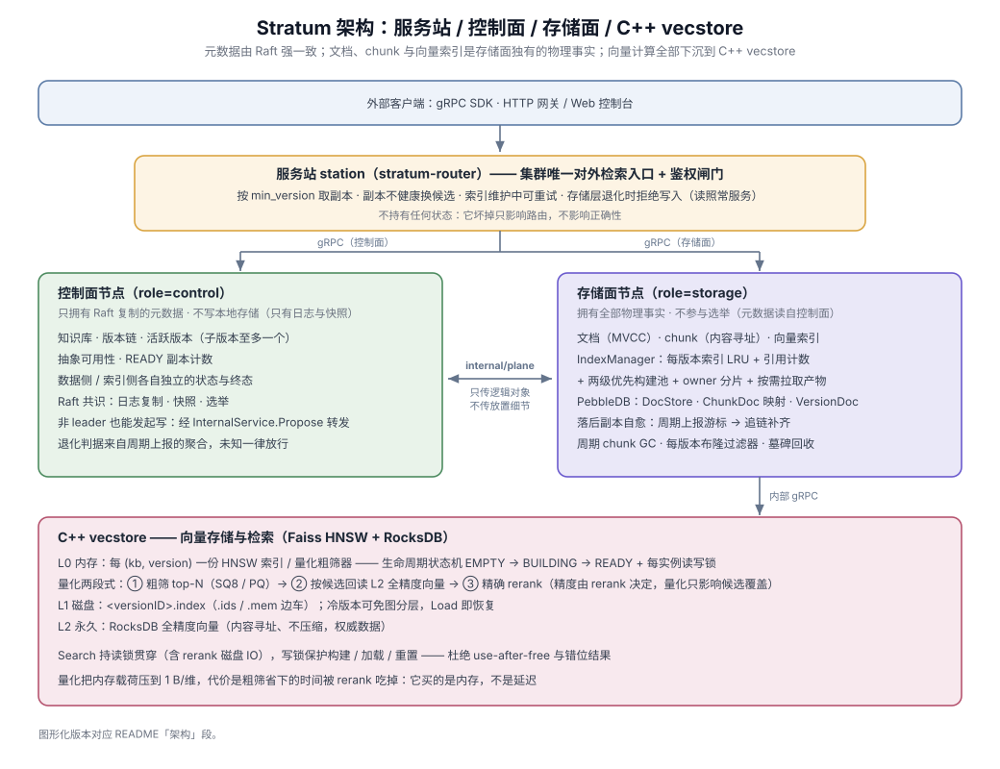
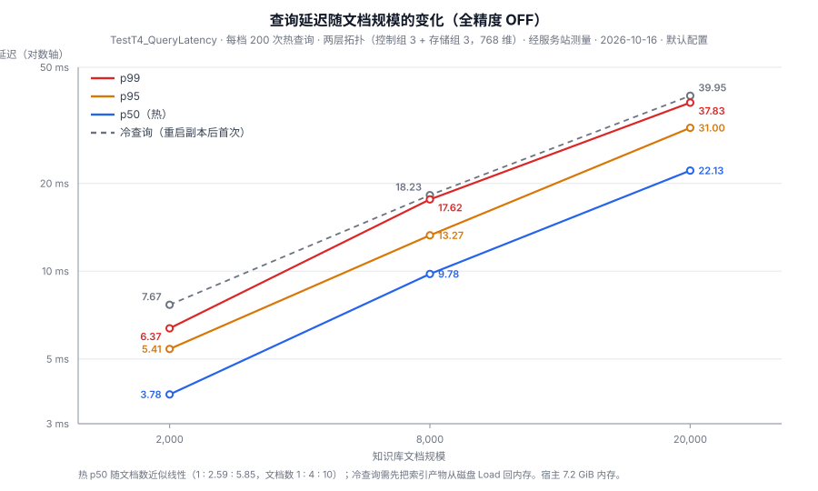
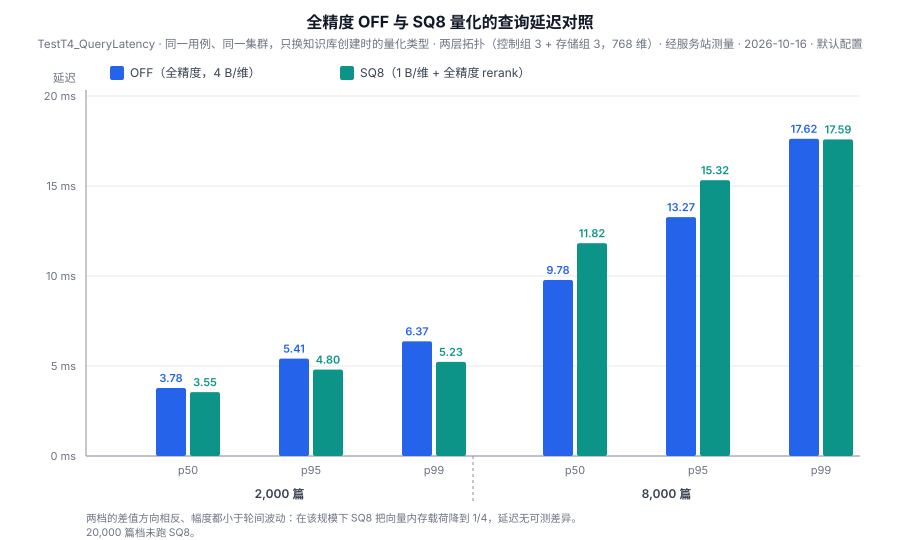

# Stratum

[](https://github.com/Hk-owo/stratum-vectordb/actions/workflows/ci.yml)
[](https://codecov.io/gh/Hk-owo/stratum-vectordb)
[](https://go.dev/doc/go1.24)
[](LICENSE)

**为 RAG 构建的分布式、版本化向量知识库。** 每次文档更新都产出一个可回滚、可审计的 MVCC 版本；元数据由自研 Raft 强一致复制，向量由 C++ Faiss HNSW 索引。

> 个人独立项目 · Go 约 4.4 万行（另有约 5.8 万行测试）+ C++ 约 7,400 行 · Raft 层由我此前的 KVServer（MIT 6.5840 路线）演进而来，未使用 etcd/raft · 在「控制组 3 + 存储组 3」的两层 Docker 集群上端到端验证

名字取自"地层"：文档的每次变更沉积成一层可独立查询、可回滚的版本；存储也分热、冷、永久三层。

---

## 它解决什么问题

RAG 的知识库不是一次写入就不动的。实际使用里有三个常见痛点：

| 痛点 | Stratum 的做法 |
|---|---|
| 更新了一批文档后检索质量变差，想**立刻退回**去 | 知识库以 MVCC 版本链组织，`RollbackVersion` 一次调用切换活跃版本，不停服 |
| 回答出错时，说不清**当时检索的是哪一版文档** | 查询永远落在一个明确的版本上，结果可追溯到产生它的版本 |
| 文档只改了一小段，却要**整篇重新 embed** | 内容定义分块（CDC）+ 内容寻址 ChunkID，未变的 chunk 原样复用、在 embed 之前就被跳过 |

Stratum 只做 RAG 管线的**存储与检索层**；聊天历史、会话与 prompt 构造属于其上的应用层。

## 关键数据

| 指标 | 结果 | 说明 |
|---|---|---|
| 查询延迟（热 p50） | **3.78 / 9.78 / 22.13 ms** | 2k / 8k / 20k 篇文档，768 维，3+3 集群，经服务站测量 |
| 中部编辑后 chunk 复用 | ChunkID 保留率 **0% → ~95%**；需重新 embed 的文本 **64% → 10%** | CDC 对比滑动窗口，同一批真实语料 |
| 索引构建次数 | **−24%**（8 个版本：21 → 16 次） | 索引 owner 分片：每版本只由 owner 集持有 |
| 墓碑回收 | 索引产物 33.1 MB → 16.2 MB（**−51%**） | 2,000 篇删除 80% 后，滚动回收，回收期间查询不中断 |
| 写入 API | 20,000 篇 / 20 批合计 **0.63 s** | 写入与索引构建解耦，构建异步进行 |
| 测试 | **1,283** 个 Go 测试函数 + vecstore **71** 个 C++ 用例 + 12 组 Docker 集群集成测试 | CI 跑单测、`-race` 与真实集群集成 |

完整读数与测量口径见下方[性能实测](#性能实测)。

## 架构



```
  客户端（gRPC SDK / HTTP 网关 + Web 控制台）
                 │
  服务站 stratum-router ── 无状态：选副本、换候选、熔断、鉴权、写入门控
        │                        │
  控制面（role=control）    存储面（role=storage）
  Raft 复制的元数据：       全部物理事实：文档(MVCC) · chunk ·
  知识库 · 版本链 ·         每版本索引 · 复制 · 追赶与修复
  活跃版本 · 副本可用性            │ gRPC
                            C++ vecstore：Faiss HNSW（L0 内存）
                            · .index 产物（L1 磁盘）· RocksDB 全精度向量（L2）
```

分层的原则是**每一层只拥有自己该知道的事**：

- **服务站**只决定"发给谁、怎么重试、要不要拒"，不持有状态，坏掉只影响路由、不影响正确性，可水平扩展；
- **控制面**只回答"哪些版本存在、谁是活跃版本、有多少副本就绪"，**不写本地数据**；
- **存储面**拥有文档、chunk、向量索引与复制；向量计算全部下沉到 C++ vecstore，Go 层只做编排。

两层之间的契约（`internal/plane` 的 `ControlPlane` / `DataPlane`）只传逻辑对象，从不暴露副本数、文件路径或节点身份，所以既能同进程运行（`role=all`，默认），也能拆成独立集群。

## 核心设计与取舍

每一条按"问题 → 做法 → 代价"组织。

### 1. MVCC 版本链，且刻意保持严格线性

- **做法**：`CreateVersion` 一次应用任意数量的 ADD / DELETE / UPDATE，产出新版本；未变更的文档借助 PebbleDB 的前缀编码零拷贝继承。父版本必须已就绪，且**最多只能有一个子版本**。
- **为什么拒绝分叉**：文档读取沿祖先链解析，两条分支会让一条分支读到兄弟分支的写入。线性链让"某版本包含哪些文档"始终有唯一答案。
- **细节**：建库时不创建版本（惰性根）——因为"空的 changes"在链中间意味着"与父版本相同"，在根部却意味着"空集"，两种语义只在根部重合，所以空 changes 直接被拒。删除支持 `SUBTREE` / `SINGLE`（子版本改挂到父版本）/ `ANCESTORS` 三种模式。

### 2. 内容定义分块 + 内容寻址 chunk

- **问题**：按固定偏移切块时，文档中部插入一句话会让其后所有 chunk 边界整体平移，全部需要重新 embed。
- **做法**：边界来自文档字节上的滚动 Rabin 指纹，再吸附到句末标点、对齐到 rune 起点（后者是正确性要求，不是调参）。`ChunkID = SHA-256(text + model ID)`，天然去重、无需跨节点协调；写路径在 **embed 之前**用 Bloom + Exists 过滤已持有的 chunk，复用真正省下 embedding 调用，复用率落进日志可观测。
- **代价**：切块算法按知识库固定、创建后不可变——同一库的不同版本必须切得一样，否则同一段文本会产出不同 ChunkID。

### 3. 每版本一份索引 + owner 分片 + 按需拉取

- **做法**：每个 (知识库, 版本) 一份独立 HNSW 索引，版本之间零干扰；索引**不在所有副本上复制**，而是按 (知识库, 版本) 确定性算出 owner 集（活跃版本所有副本都是 owner，非活跃版本按近期是否被查询加档）。需要索引的副本向持有者**拉取**产物直接装载，拉不到再自建；同一版本的并发拉取会合并成一次读盘。
- **调度**：构建池是两级优先队列——有人在等的实时构建永远先于后台补建，补建积压再多也挡不住一次实时写入。
- **代价**：构建总成本随**版本数**超线性增长（8 批 → 20 批：48 s → 266 s）。owner 分片减少的是持有份数，而非单份成本；纯追加的版本会以父版本产物为起点只追加新 chunk 来缓解。

### 4. 自研 Raft + WAL，围绕"崩溃后仍然正确"设计

- 元数据写经 leader 提交，并受 WAL 保护；快照不阻塞心跳与写入。
- **任何节点都能发起写**：非 leader 经 `InternalService.Propose` 转给 leader，不成链；错误以稳定的 wire name 跨进程传递，转发后 `errors.Is` 依然成立。
- **写幂等**：`CreateVersion.client_request_id` 让重试复用首次分配的版本，而不是再分配一个。
- 存储节点的"连续数据游标"同样持久化在 WAL 中，重启后立即准确，不靠扫描磁盘推断。

### 5. 卡住的版本必须有名字

一个只会"一直 PENDING"的版本对调用方毫无信息量。Stratum 把版本状态拆成**数据侧**（PENDING / DURABLE / FAILED_PERMANENT）与**索引侧**（PENDING / READY / FAILED / FAILED_PERMANENT）两条独立的线：

- **DATA_MISSING**：没有任何副本持有数据（例如写入方在分配版本后崩溃）——客户端可按同一幂等键重发，或 `DiscardVersion` 放弃；
- **FAILED_PERMANENT**：重试预算耗尽，只有运维能 `ForceRetryVersion`（仅限索引侧）或 `ForceAbandonVersion`；
- **只有数据侧终态才触发物理回收**——索引构建失败不代表数据坏了，删掉数据会毁掉重建所需的输入。

### 6. 落后副本自愈 + 读的新鲜度凭证

- 存储节点每 5 秒上报游标，leader 在响应里捎带每个知识库的链尾；落后节点在后台先补数据、再补索引。缺口能逐版本重放时走 WAL 增量，缺口里含已删除版本时退回全量状态传输。这里**没有开关**，能调的只是节奏（滞后阈值、抖动、并发上限）。
- 数据源解析有四层兜底：本地注册表 → leader → 游标探测 → 控制层下发的 holders 镜像（心跳捎带，查表即得，绝不在 Raft apply 路径上发 RPC）。
- 服务站转发查询时附上"应看到的最低版本"，存储节点游标不够就拒——**把"悄悄返回过时结果"变成显式失败**，再换一个达标副本。

### 7. 存储退化是显式信号：写拒绝、读照常

- 副本低于 quorum 时写入返回 `kb_storage_degraded` / `storage_unavailable`（可重试），读照常服务，查询响应带 `storage_degraded` 位，只读客户端无需先撞一次写失败才知道。
- 判据复用已有的周期上报，**判不出时一律放行**：leader 换届瞬间变成写熔断是不可接受的。
- 两道门：服务站转发前拦一次（省掉往返），控制面在提交 Raft 前再拦一次（不浪费版本号与日志），两处报同一个错误名。

### 8. 可选的量化两段式检索

- 建库时可选 `SQ8` / `SQ_FP16` / `SQ_BF16` / `PQ`：内存只驻留量化粗筛器，查询先粗筛候选，再读 RocksDB 中的全精度向量精确 rerank——**最终精度由 rerank 决定，量化只影响候选覆盖**。
- 选型：对比 hnswlib（无量化）、DiskANN、USearch 后选 Faiss 内建 `IndexHNSWSQ` / `IndexHNSWPQ`，零新依赖，与现有序列化格式兼容。
- 码本会随数据分布漂移，所以累积新增向量比例或追加次数越界时自动全量重训。
- **实测结论**：在 2 万篇以内的规模，量化买到的是内存（4 B/维 → 1 B/维），不是延迟。

### 9. 服务站与网关分成两层，安全边界只有一处

- 服务站（gRPC，`:7009`）负责 leader 发现、写转发、读均衡、熔断与鉴权；网关（HTTP，`:8081`）只做 HTTP→gRPC 转换并托管 Web 控制台，不知道集群拓扑。程序接入只需服务站，网关是可选适配层。
- 节点只接受带服务站信任标记的客户端调用，标记是带时间戳的 **HMAC-SHA256**，不可伪造且过期即失效；vecstore 的文件类 RPC 只允许在索引目录内读写，且明确排除 RocksDB 目录。

## 工程实践

- **测试**：33 个 Go 包中 28 个带测试，共 1,283 个测试函数；vecstore 71 个 C++ 用例；`integration/docker` 在真实 3+3 集群上覆盖幂等、追赶、退化、换出、回收等场景。CI 跑单测 + 覆盖率、`-race`（共识与索引核心）与 Docker 集成。
- **可观测**：三态健康检查、Prometheus `/metrics`、查询分段计时（`query: stage timings`），以及 `GetSystemStatus` 中的卡住 / 数据缺失 / 永久失败 / GC 受阻版本列表。

## 性能实测

> 2026-10-16，两层拓扑（控制组 3 + 存储组 3，每个存储容器自带真实 Faiss HNSW + RocksDB，768 维），宿主 7.2 GiB 内存，经服务站测量，**默认配置**（owner 分片开启、墓碑回收开启、冷版本分层关闭）。轮间差异主要来自宿主与页缓存状态，因此只比较同一轮内的数据。

### 查询延迟（全精度，`TestT4_QueryLatency`，每档 200 次热查询）



| 指标 | 2,000 篇 | 8,000 篇 | 20,000 篇 |
|---|---|---|---|
| 冷查询（重启副本后首次，需从磁盘 Load） | 7.67 ms | 18.23 ms | 39.95 ms |
| p50（热） | **3.78 ms** | **9.78 ms** | **22.13 ms** |
| p95 | 5.41 ms | 13.27 ms | 31.00 ms |
| p99 | 6.37 ms | 17.62 ms | 37.83 ms |

热 p50 随文档数近似线性。冷热分开报：首次查询要把产物从磁盘装回内存，两者混在一起取平均既不描述常见情况，也不描述最坏情况。

### 查询耗时构成（存储节点内，µs）

| 段 | 做什么 | 2,000 篇 p50 | 8,000 篇 p50 |
|---|---|---|---|
| `filter_us` | 候选的版本过滤 + 聚合 | **2061** | **6722** |
| ↳ `chunkmap_us` | 每个候选 chunk 查一次所属文档 | 1138 | 2903 |
| `meta_us` | 读版本元数据 | 295 | 345 |
| `search_us` | vecstore HNSW 检索 | 324 | 381 |
| `read_us` | 读命中文档正文 | 87 | 157 |
| `bloom_us` | 布隆过滤 + 文档 ID 集合 | 37 | 164 |
| **`total_us`** | 合计 | **3026** | **9005** |

（`debug` 日志级别下采集，绝对值略高于 `info` 级，此表看构成与占比。）

### 量化对照（`SQ8` vs 全精度）



| 热 p50 | 2,000 篇 | 8,000 篇 |
|---|---|---|
| `OFF` | 3.78 ms | 9.78 ms |
| `SQ8` | 3.55 ms | 11.82 ms |

两个方向的差值都小于轮间波动，结论是"内存降为 1/4，延迟无可测差异"。

### 写入与索引构建（`TestT4_DataVolume`，每批 1,000 篇）

| 规模 | 写入 API 合计 | 累计索引构建 | 端到端 |
|---|---|---|---|
| 2,000 篇（2 批） | 52.8 ms | 9.90 s | 10.7 s |
| 8,000 篇（8 批） | 200.6 ms | 48.27 s | 49.5 s |
| 20,000 篇（20 批） | 626.9 ms | 4 m 25.6 s | 267.8 s |

写入 API 几乎与规模无关，代价集中在索引构建，并随版本数超线性增长。干净环境下 20,000 篇的 3 节点数据目录合计 346 MiB。

## 快速开始

```bash
# 构建与测试
go build ./cmd/stratum/
go test ./... -timeout 180s -count=1
go test -race ./internal/kvraft/... ./internal/raft/... ./internal/index/...

# 一键拉起完整链路：vecstore(C++) → stratum → 服务站 → 网关 + Web 控制台
scripts/gateway.sh --with-db        # 然后打开 http://localhost:8081

# 3 节点 Docker 集群（与 CI 相同）
scripts/cluster.sh up 3 --with-embed
go test ./integration/docker/... -tags=docker -timeout 300s
scripts/cluster.sh down

# 两层拓扑：控制组 1..3 + 存储组 11..13 + mock-embed
scripts/cluster.sh --topology two-tier build
scripts/cluster.sh --topology two-tier up
```

更多脚本用法见 [`scripts/README.md`](scripts/README.md)。

## 代码导读

| 路径 | 内容 |
|---|---|
| `internal/kvraft` | Raft 共识：选举、日志复制、快照、持久化 |
| `internal/raft` | 版本元数据状态机：版本链、活跃版本、终态裁决、提案转发 |
| `internal/wal` | 预写日志：写事务、数据游标、变更记录（供落后副本增量重放） |
| `internal/coordinator` | 写路径编排、版本删除、chunk GC、per-KB 写锁 |
| `internal/plane` | 控制面 / 存储面契约及同进程实现；追赶、数据源解析、按需拉取索引 |
| `internal/index` | 索引管理：LRU 驻留、引用计数、两级优先构建池、保留与墓碑回收 |
| `internal/nodestate` | 存储节点状态机：每版本状态与连续数据游标 |
| `internal/splitter` | 内容定义分块（Rabin 指纹）与滑动窗口对照实现 |
| `internal/docstore` · `chunkdoc` · `versiondoc` · `bloom` | PebbleDB 上的 MVCC 文档存储、chunk↔文档映射、版本文档集、每版本布隆过滤器 |
| `internal/router` · `cmd/stratum-router` | 服务站：路由表、新鲜度凭证、熔断、鉴权、写入门控 |
| `internal/sync` | 节点间数据推送 / 拉取 / 增量流 |
| `service/` | 对外 gRPC 服务实现 |
| `vecstore/` | C++17 向量存储：Faiss HNSW / 量化粗筛 + RocksDB 全精度向量 |
| `cmd/stratum-gateway` · `web/` | HTTP 网关、运维台与 Web 控制台 |
| `integration/` | 进程内集成测试与 Docker 集群测试 |

---

## 参考

<details>
<summary><b>版本与一致性细节</b></summary>

- **"已删"只看当前状态**：判定版本是否已删除只依据两件当前事实——版本号是否已被分配（单调计数器，随快照走），以及是否仍在存活版本集合中。判定不依赖任何需要保留的历史记录；版本链 backfill 与启动对账共用同一判据，控制节点与纯存储节点答案一致。
- **布隆过滤器**：每版本一份完整文档 ID 集合的布隆过滤器，磁盘副本缺失时从版本文档集重建。
- **chunk GC**：周期（默认 5 分钟，`gc.sweep_interval_s`）清扫不再被任何版本引用的 chunk。先无锁枚举候选，再按 Raft 当前版本复查后删除，复查与删除和同一知识库的写入共用 per-KB 写锁，不依赖过期快照。只有 `ErrVersionNotFound` 被视为"文档已死"，其他读错误上报并重试。
- **新子版本的文档集校验**：用元数据中父版本的 `doc_id_set_hash` 校验继承的文档集，不一致返回可重试错误，避免把"本节点读不到父版本"当成"父版本没有文档"。
- **判死后的回收**：每个 Raft 成员从自己的 apply 得知终态后本地清理（广播只是尽力而为的一次性通知），启动时再扫一次补回。不参与 Raft 的纯存储节点只有"检测者就地清"与"重启时扫一次"两条路径；残留只占空间、不影响正确性。
- **数据侧终态推进**：存储节点的数据游标随上报上行，控制层据此把版本从 PENDING 提升为 DURABLE（只提升仍存在且非删除中的版本）。
- **增量追赶的退化条件**：缺口中只要含已确认删除的版本就整段退回全量状态传输——跳过被删版本继续重放会丢文档，因为那些版本的文档集要由已不存在的父版本推出。元数据读不到时不退化。

</details>

<details>
<summary><b>索引生命周期：保留、分层与回收</b></summary>

- **保留**：每个知识库保留 `gc.version_retention_count`（默认 50）个最新版本的产物。**访问保护**另外保留窗口内（默认 24 h）被查询过的版本，上限默认同为 50，访问时间写在旁车文件里，重启后仍有效。`RebuildIndex` / `WarmupVersion` 也会登记访问。
- **冷版本免图分层**：版本连续 `cold_threshold_ms`（默认 0 = 关闭）未被查询时，以"量化码 + 暴力扫描"的免图形态构建，查询语义不变；在阈值一半内被查询则重建回带图形态，两阈值之间是迟滞带。形态随产物旁车走，拉取或重启后都能正确识别。
- **纯追加复用**：版本 N 只是 N−1 的纯追加且父产物在本地时，以父产物为起点只追加新 chunk；墓碑占比超过 `append_max_dead_ratio`（默认 0.2）时改为全量重建。
- **墓碑回收**：默认开启的滚动回收——一次只动一个副本，该副本临时退出服务池（查询返回可重试哨兵，服务站换候选）。墓碑占比超过 `gc_ratio_threshold`（默认 0.3）时触发；收集前确认"除我之外至少还有 `serving_replica_min`（默认 1）个副本在服务"，否则以 `gc_blocked_versions` 上报。回收门槛必须高于复用门槛，否则追加路径总会抢先重建、回收永远看不到候选——这一约束由测试钉住。带图形态只能整图重建（Faiss HNSW 不支持删点），阈值 `graph_rebuild_ratio` 默认 0.5。
- **码本重训**：对 `SQ8` / `PQ`，自上次训练以来新增向量超过基线的 `max_codebook_drift_ratio`（默认 0.25）或追加次数超过 `max_codebook_appends`（默认 50）时全量重建；免训练类型不参与判定。
- **残留回收**：构建失败留下的临时文件按 mtime 超过 `build_abandon_timeout_ms`（默认 30 分钟）回收；同一版本产物的读写另有分片锁。
- **vecstore 生命周期**：每个索引实例显式区分 `EMPTY` / `BUILDING` / `READY`，读锁贯穿查询（含 rerank 磁盘 IO），写锁保护构建、加载与重置，避免并发下的 use-after-free 与错位结果。

量化类型对照（d=768、n=100 万单版本的示例内存）：

| 类型 | 每向量载荷 | 训练 | 示例内存 | 备注 |
|---|---|---|---|---|
| `OFF`（默认） | 4 B/维 | 无 | ≈ 3.07 GB | 单段精确检索 |
| `SQ8` | 1 B/维 | 首批一次 | ≈ 768 MB | 召回 ≈ 全精度 |
| `SQ_FP16` | 2 B/维 | 免训练 | ≈ 1.54 GB | 推荐档 |
| `SQ_BF16` | 2 B/维 | 免训练 | ≈ 1.54 GB | 无硬件 bf16 时延迟约 7× |
| `PQ`（m, 8-bit） | m B/向量 | 首批 k-means | ≈ 96 MB（m=96） | 召回随候选数提升 |

量化路径的候选数默认为 `clamp(top_k × 8, 16, 4096)`，可用 `index_manager.candidate_n` 覆盖。

</details>

<details>
<summary><b>部署形态与配置</b></summary>

- **单节点**：`cmd/stratum`（gRPC，默认 `127.0.0.1:7000`）+ 外部 C++ vecstore 进程。`cmd/stratum` 接受可选 YAML 配置，命令行 flag 优先：`go run ./cmd/stratum/ -config integration/docker/config1.yaml`。
- **角色分离**：`node.role` 取 `all`（默认，两层同进程）、`control`（只有 Raft 日志与元数据，不建数据目录）、`storage`（只跑存储层，不参与选举，元数据经 `RemoteRaftNode` 读取）。存储组由 `storage.nodes` 声明，省略即每个 Raft 成员都持有数据。
- **两层拓扑的硬约束**：控制层 ID（`1..N`）与存储层 ID（`11..1N`）不得重叠；写入由控制层在 apply 时指派给某个存储节点执行（`ExecuteVersionWrite`），该节点作为协调者再扇出。

```yaml
# 一个只跑存储层的节点：数据在这里，元数据在控制集群
node:
  node_id: 4
  role: storage            # all(默认) | control | storage
raft:
  peers:                   # 控制集群成员
    - id: 1
      addr: "node1:8000"
      service_addr: "node1:7000"
storage:
  nodes:                   # 存储组
    - id: 4
      addr: "node4:7000"
```

- **vecstore 路径闸门**：索引文件类 RPC（`Save` / `Load` / `LoadForAppend` / `ExistsIndex`）只允许在 `--index_dir` 内读写，默认 `<rocksdb_path 的父目录>/index`，并始终排除 RocksDB 目录本身；部署脚本与网关 supervisor 传节点级的 `<data_dir>/index`。
- **服务站鉴权**：客户端凭据只在服务站校验（`-tokens`，按 token 的 sha256 存取，拒绝空 token），`kb_ids: ["*"]` 表示所有知识库。节点侧要求三个对外服务带服务站的 HMAC 信任标记（`-station-secret` / `node.station_secret`，两边必须成对配置）；节点间服务不受影响。
- **网关**：默认只绑回环 `127.0.0.1:8081`（`/ops` 能启停服务）。控制台的兜底凭据只施加给同源的 `/api/*` 请求，其余匿名请求返回 401；`bin_dir`、编排脚本路径、`station_secret` 等决定"执行什么"的字段不接受 HTTP 改写。
- **环境变量**：`STRATUM_HTTP_ADDR`、`STRATUM_ROUTER_ADDR`（默认 `127.0.0.1:7009`）、`STRATUM_GRPC_ADDR`、`STRATUM_STATION_SECRET`、`STRATUM_STATION_TOKENS`。
- Docker 集群模式下若 vecstore 跑在宿主机，需监听 `0.0.0.0:7100`，否则容器内无法访问。
- 浏览器打不开 `:7009` 是正常的：那是 gRPC 端口，看界面请用网关 `:8081`。

</details>

<details>
<summary><b>gRPC API</b></summary>

Protobuf 定义在 `api/proto/`：三个对外服务，加三个只供节点间使用的内部服务。

**KnowledgeBaseService**

| RPC | 说明 |
|---|---|
| `CreateKnowledgeBase` | 创建知识库（embed 配置、切块参数、索引与量化类型），不创建版本 |
| `DeleteKnowledgeBase` | 标记删除，清理异步执行 |
| `CreateVersion` | 应用文档变更产出新版本；可带幂等键 `client_request_id`；空 changes 被拒 |
| `ListVersions` | 版本链，含数据侧与索引侧状态 |
| `RollbackVersion` | 切换活跃版本，无停机 |
| `ListKnowledgeBases` / `GetKnowledgeBase` | 列出 / 查询知识库（按调用方权限裁剪） |
| `DeleteVersion` | `SUBTREE` / `SINGLE` / `ANCESTORS` 三种模式，活跃与 PENDING 版本不可删 |
| `AwaitVersion` | 等待版本达到 `DATA_DURABLE` 或 `INDEX_READY`；"还没好"正常返回 `stage` + `retry_after_ms`；事件驱动；带 `data_missing` |
| `DiscardVersion` | 放弃一个从未落地的 PENDING 版本，清掉幂等键映射 |
| `GetDataVersionHolders` | 哪些节点报过持有该版本（软状态），附带存储退化判定与诊断 |

**QueryService**

| RPC | 说明 |
|---|---|
| `Query` | 向量相似度检索（阈值、top-k、聚合）；响应带 `storage_degraded` |

**AdminService**

| RPC | 说明 |
|---|---|
| `HealthCheck` | 三态健康检查；存储退化只写进 `Details`，不改状态位（读仍在服务） |
| `GetSystemStatus` | 卡住、数据缺失、永久失败、GC 受阻、删除中的版本，WAL 告警与资源占用 |
| `GetClusterStatus` | 节点的 Raft 视图，供服务站发现 leader |
| `RebuildIndex` / `WarmupVersion` | 重建 / 预热版本索引（先校验版本属于该知识库） |
| `ListFailedVersions` | 列出 FAILED_PERMANENT 版本及原因链 |
| `ForceRetryVersion` | 撤销索引侧终态并重建（数据侧终态不可重试） |
| `ForceAbandonVersion` | 放弃判死版本，按 `DeleteVersion` 的 `SINGLE` 语义处理 |

**内部服务**（不对外）

| 服务 | RPC |
|---|---|
| `InternalService` | `Propose`：把已编码的 Raft 命令交给 leader，非 leader 回传 `leader_id` |
| `DataSyncService` | `ExecuteVersionWrite`（执行已提交版本的写事务）· `PushVersionData` / `PullVersionData` / `PullVersionChanges`（全量与增量传输）· `LocalVersion` / `VersionPresence`（游标与持有探测）· `ReportDataVersions`（周期上报，响应捎带链尾与 holders 镜像）· `DeleteVersionData`（物理回收，无法执行时以错误回答）· `ConfirmVersionWrite` · `FetchIndexData`（按需拉取索引产物） |
| vecstore（C++） | 索引构建、加载、检索与 chunk 向量存储 |

</details>

## License

[MIT](LICENSE)
